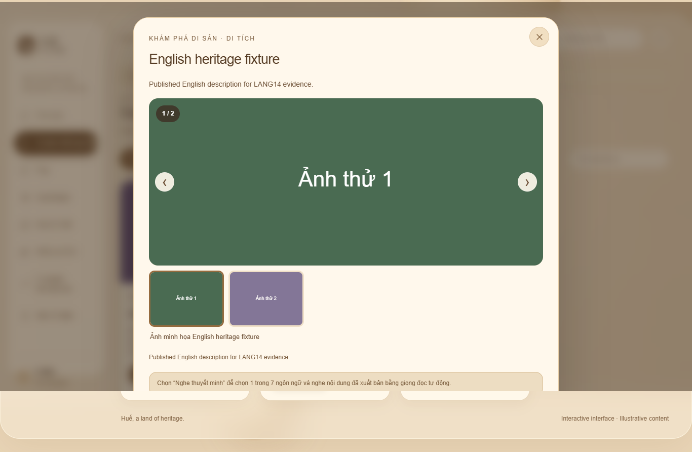
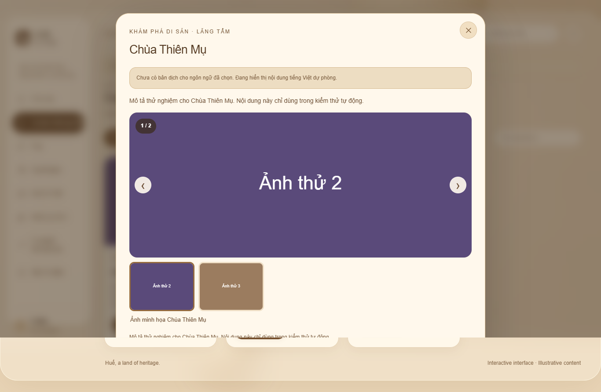
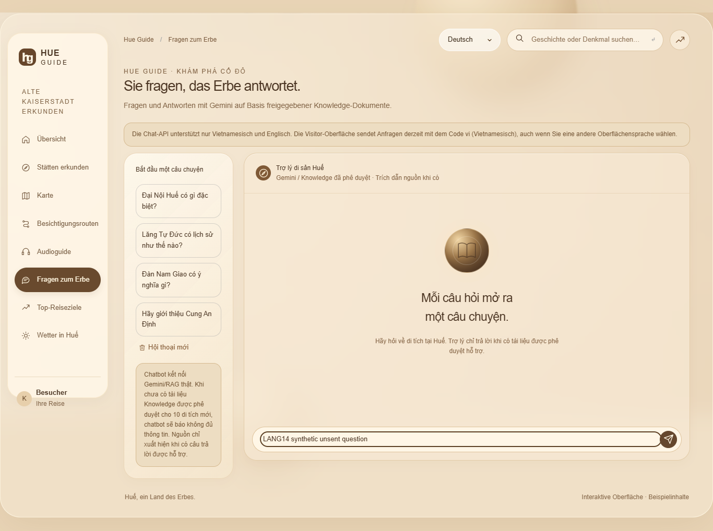

# LANG14 — bàn giao QA ngôn ngữ Visitor

## Mốc và bằng chứng

Bàn giao ngày **10/11/2026**. Lần chụp/kiểm tra LANG14 dùng commit
**89046bffb5a99e70de89c2662e56bc1b4a191810** (`89046bf`), Chrome đã cài trên
Windows **157.0.8103.39**, Playwright **1.65.0** cài tạm ngoài repo.
**Kết quả cuối LANG14: PASS 18/18, FAIL 0**, với API giả lập và dữ liệu tổng hợp.
Đây là kết quả lượt nghiệm thu trước, không phải test vừa chạy lại khi sửa tài liệu.

Nguồn: [summary.json](assets/lang14/summary.json),
[report lần đầu](assets/lang14/report.json),
[report chạy lại Audio](assets/lang14/report-audio-retry.json).
Ảnh chụp bằng Chrome thật trên Windows; dữ liệu không đến từ Backend/DB thật.
Các ảnh ghi “published” chỉ mô phỏng contract published, không chứng minh nội dung
thật đã được duyệt. Hướng dẫn thao tác và bảng phạm vi ở
[Visitor language](visitor-language.md); kế hoạch nghiệm thu thực địa ở
[Visitor UAT](visitor-uat.md).

**LANG13: PASS 111/111 local tại `89046bf`** là kết quả đã có từ lượt trước do
người bàn giao cung cấp. Không chạy lại bộ LANG13 để viết tài liệu; không có log
LANG13 trong gói bằng chứng này để đối chiếu từng ca hoặc suy ra mức tích hợp thật.
Không cộng LANG13 và LANG14 thành số ca độc lập vì có thể trùng phạm vi kiểm tra.

## Checklist và báo cáo LANG14

| Hạng mục đã chạy | Số ca | Kết quả cuối | Assertion / bằng chứng |
| --- | --- | --- | --- |
| Giao diện vi/en/zh/ja/ko/fr/de ở 1366px | 7 | PASS | Selector, html lang (`zh-CN` cho zh), nhãn Map theo từ điển; tên di tích từ fixture |
| Chi tiết tiếng Anh | 1 | PASS | Request list/detail có `language=en`; tên/description đúng fixture en |
| Chi tiết fallback tiếng Việt | 1 | PASS | Giữ tên/description vi và hiện thông báo tiếng Việt dự phòng |
| Reload giữ en | 1 | PASS | Selector và html lang=en; request danh sách đầu tiên sau reload dùng en |
| Chat en → de → vi | 1 | PASS | DE hiện thông báo đúng từ điển, VI ẩn; draft không mất; hai ảnh nhưng chỉ một ca |
| Audio nội dung tiếng Anh | 1 | PASS sau chạy lại | Chọn đúng di tích #1, transcript tiếng Anh và locale en-US |
| Audio JA thiếu bản dịch | 1 | PASS | Locale ja-JP, thông báo chưa có nội dung, nút Phát disabled; chưa nghe voice |
| Tuyến trống tiếng Anh | 1 | PASS | Heading đúng `empty.routes` tiếng Anh |
| Di tích lỗi API 500 | 1 | PASS | Nút Reload đã dịch, không hiển thị card dữ liệu mẫu |
| Bố cục DE/FR/JA ở 390px | 3 | PASS | Selector hiển thị; độ tràn ngang ≤1px; viewport giả lập, không phải điện thoại thật |
| **Tổng ca duy nhất** | **18** | **PASS 18, FAIL 0** | Gốc có 19 ảnh; chọn 9 ảnh tiêu biểu để đưa vào repo |

### Lần lỗi Audio và chạy lại

Lần đầu **17 PASS, 1 FAIL**: `audio-en-content` timeout sau 12 giây khi chờ
description tiếng Anh của fixture di tích #1. Script tạm đã giả định di tích mặc
định là #1, trong khi ứng dụng chọn theo thứ tự tên. Sửa riêng script kiểm chứng
ngoài repo để bấm track `di-tich-01`, rồi kiểm tra đúng nội dung/locale:
**chạy lại 1 PASS, 0 FAIL**. Không sửa ứng dụng để làm test đạt.

Giữ nguyên byte của cả hai log, kể cả lỗi lần đầu:

- [run.log — bản sao nguyên gốc](assets/lang14/run-original.log.txt).
- [audio-retry.log — bản sao nguyên gốc](assets/lang14/audio-retry-original.log.txt).

Đuôi `.txt` giúp lưu bằng chứng trong repo mà không vướng quy tắc ignore `*.log`;
nội dung log không bị chỉnh sửa. Hai file `.log` nguồn vẫn còn trong thư mục tạm.
`summary.json` tổng hợp kết quả cuối theo tên ca; lần chạy lại không tạo ca thứ 19.

## Ảnh tiêu biểu — API giả lập

| Ảnh | Ca / nội dung minh chứng |
| --- | --- |
| [detail-en.png](assets/lang14/detail-en.png) | Tên và mô tả tiếng Anh theo fixture |
| [detail-vi-fallback.png](assets/lang14/detail-vi-fallback.png) | Nội dung vi kèm thông báo dự phòng khi chọn en |
| [chat-draft-de-notice.png](assets/lang14/chat-draft-de-notice.png) | Thông báo giới hạn bằng tiếng Đức, còn câu hỏi nháp |
| [chat-draft-vi-hidden.png](assets/lang14/chat-draft-vi-hidden.png) | Quay về vi: ẩn thông báo, giữ cùng draft |
| [audio-en-content.png](assets/lang14/audio-en-content.png) | Di tích #1 có transcript en và locale en-US sau chạy lại |
| [audio-ja-fallback-disabled.png](assets/lang14/audio-ja-fallback-disabled.png) | JA thiếu bản dịch, không cho đọc nội dung fallback bằng giọng JA |
| [responsive-de-390.png](assets/lang14/responsive-de-390.png) | Viewport 390px giả lập, nhãn tiếng Đức |
| [routes-empty-en.png](assets/lang14/routes-empty-en.png) | Trạng thái tuyến trống đã dịch |
| [explore-error-en.png](assets/lang14/explore-error-en.png) | Lỗi di tích và nút Reload |

Chi tiết tiếng Anh (dữ liệu tổng hợp):



Fallback tiếng Việt, không giả làm bản dịch tiếng Anh:



Chat đổi sang tiếng Đức và giữ draft chưa gửi:



## Lệnh và cách đối chiếu

Lượt LANG14 dùng runner chụp ảnh có assertion đặt **ngoài repo**, tái sử dụng
[harness](../tests/frontend/_support/visitor-harness.cjs). Runner không phải script
đã commit; hai lệnh dưới cần các file tạm gốc còn tồn tại. Không coi chạy lại
[smoke LANG12](../tests/frontend/visitor-language-smoke.cjs) là đã tái chạy đúng
18 ca chụp ảnh LANG14.

```powershell
$env:NODE_PATH = Join-Path $env:TEMP 'hue-lang12-playwright\node_modules'
$env:SHOT_DIR = Join-Path $env:TEMP 'hue-lang14-b4282fbb0c5f45deb9a01b16fea854b9'
node (Join-Path $env:SHOT_DIR 'capture-lang14.cjs') 89046bffb5a99e70de89c2662e56bc1b4a191810
node (Join-Path $env:SHOT_DIR 'capture-lang14-audio-retry.cjs') 89046bffb5a99e70de89c2662e56bc1b4a191810
git diff --check
```

Các lệnh trên ghi lại lần nghiệm thu, không tự cài dependency hoặc đọc `.env`.
Browser và HTTP server tạm được đóng trong `finally`; giữ ảnh/log để bàn giao.
Không khởi động Backend/DB, không gửi câu hỏi lên Chat provider thật.

## Phần còn phải nghiệm thu

| Phạm vi | Trạng thái | Điều kiện / giới hạn |
| --- | --- | --- |
| Android thật | CHƯA CHẠY | Cần thiết bị và trình duyệt thực tế; 390px chỉ là viewport giả lập |
| iOS thật | CHƯA CHẠY | Cần iPhone/iPad, Safari và thao tác cảm ứng thật |
| GPS thật và hộp thoại quyền | CHƯA CHẠY | Cần thiết bị, vị trí thực và HTTPS; không suy ra từ GPS mock |
| Nghe giọng TTS thực tế | CHƯA CHẠY | Cần kiểm tra voice có sẵn, âm thanh, phát/dừng và chất lượng từng ngôn ngữ |
| API/DB thật, localization published | CHƯA CHẠY | Cần môi trường riêng và fixture được cấp quyền; chưa kết nối trong LANG14 |
| File media/uploads thật | CHƯA CHẠY | Ảnh dùng SVG tổng hợp từ mock, không xác minh MIME/quyền/published của file thật |
| Chat API/provider thật | CHƯA CHẠY | Ca Chat chỉ đổi UI và giữ draft, không gửi câu hỏi hoặc xác minh câu trả lời thật |
| Staging/HTTPS/proxy | CHƯA CHẠY | Cần URL/quyền truy cập được cấp; local HTTP harness không thay thế staging |
| Người thạo ngôn ngữ duyệt bản dịch | CHƯA CHẠY | Ảnh/so sánh từ điển không chứng minh chất lượng ngôn ngữ |

LANG14 không xác nhận production ready. Nhãn còn tiếng Việt trong ảnh phản ánh
phạm vi từ điển hiện tại; tên tuyến/stops tiếng Việt và giới hạn Chat không được
coi là bản dịch đa ngôn ngữ hoàn chỉnh. Không điền PASS cho các mục trên bằng kết
quả local mock hoặc kết quả lịch sử LANG13.
